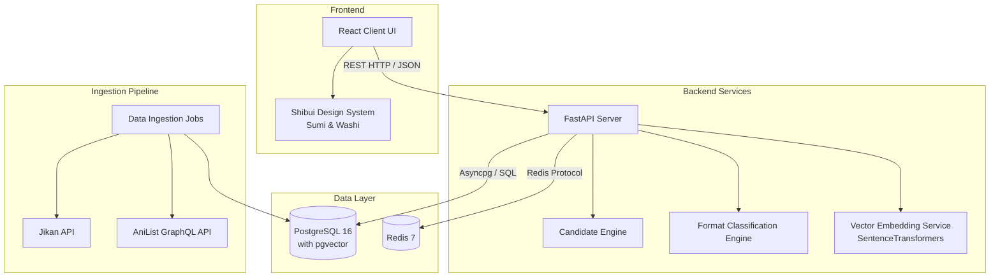

# Mitsu System Architecture

This document outlines the high-level architecture, technology stack, and core subsystems of the **Mitsu** manga discovery and recommendation engine.

## 1. System Overview

Mitsu is a full-stack, AI-powered manga recommendation system built over a database of 95,000+ manga titles sourced from Jikan (MyAnimeList) and AniList. 

It provides:
- Natural language query vector search
- Multi-field database filtering
- LLM recommendation reasoning
- Hybrid trope comparison ("Like X but Y")
- Instant Redis-backed Discovery Roulette
- Japanese-aesthetic UI (Sumi Ink & Washi Paper themes)

## 2. High-Level Architecture Diagram

## 3. Technology Stack

### Frontend
- **Framework**: React (Vite)
- **Styling**: Vanilla CSS (CSS Variables for tokens)
- **Design System**: Custom Japanese Shibui aesthetic (Sumi & Washi themes, Mon glyphs)

### Backend
- **Framework**: FastAPI on Python 3.13 (the interpreter the suite is verified on; `requirements.txt` pins every runtime and test dependency)
- **Vector Model**: `fastembed` serving `sentence-transformers/all-MiniLM-L6-v2` (384-dimensional embeddings), with `BAAI/bge-small-en-v1.5` as a logged fallback
- **Persistence**: Alembic owns the schema. Nothing writes DDL at startup or during ingestion; the app verifies the revision and logs `alembic upgrade head` if the database is behind (`docs/MIGRATIONS.md`)
- **Middleware**: Brotli ASGI compression with GZip fallback

### Data & Caching
- **Database**: PostgreSQL 16 + `pgvector` extension
- **Connection Pooling**: `asyncpg` / `psycopg2` (`pool_size=15, max_overflow=20`)
- **Cache/Queue**: Redis 7

## 4. Core Subsystems

### 4.1. Format Classification Engine
A zero-leakage isolation engine that ensures Manga, Manhwa, and Manhua results do not cross-contaminate.
- **SQL Level**: Mutually exclusive `WHERE` clauses based on Unicode ranges (Hangul, Hanzi, Kana) and tags.
- **Python Level**: Post-retrieval label inference mirroring the SQL logic to gracefully handle ambiguous entries.

### 4.2. Redis-Backed Candidate Engine (Discovery Roulette)
Designed for high-performance, low-latency candidate draws ("Surprise Me" feature).
- **Candidate Pools**: Pre-generated and stored in Redis under `roulette:pool:{filter_hash}`.
- **Session Tracking**: Deduplication via Redis Sets to ensure users never see the same manga twice in a session.
- **Atomic Refill**: Non-blocking background refill using Redis locks. Isolated `AsyncSessionLocal()` sessions prevent database connection collisions.
- **Sampling**: Replaced slow `ORDER BY RANDOM()` with fast pseudo-random `hashtext()` ordering.

### 4.3. Data Ingestion & Enrichment Pipeline
A modular, decoupled pipeline for building the manga database:
- **Discovery**: Iterative scraping of targets from Jikan API into `manga_raw`.
- **Enrichment**: Augmentation with AniList GraphQL metadata (tags, high-res covers).
- **Merge**: Deduplication and linking of MAL/AniList IDs into `manga_canonical`.
- **Embedding**: Batch generation of 384-dimensional dense vectors combining synopsis, genres, and tags.

### 4.4. State-Driven Frontend Boarding Pass Slider
The core Discovery Roulette UI is controlled by a continuous 4-step state machine:
1. Current card slides off-screen left.
2. Loading capsule with Mitsu Mon Glyph (`❖`) slides in from right to center.
3. System waits for backend API response and **100% image pre-loading**.
4. Loading capsule slides left as the new card slides in from the right.

### 4.5. Explore: one surface with a Trending Rail
Explore answers one question at a time. Its arrival state is the ranking; a
result set replaces the ranking with the answer.

- **Arrival (no result set).** Hero banner, search bar, then a `TRENDING` label,
  a hairline rule, a **Manga / Manhwa / Manhua toggle** and a horizontal rail of
  the top ten covers of the selected format. The rail reuses the detail modal's
  card (`SimilarCoverItem`) through one shared `CoverRail`, so the modal and the
  page cannot drift apart. The toggle is local UI state: it changes what the rail
  shows, never the URL, so no history entry is created and nothing on the page
  redirects anywhere.
- **One request per format**, cached server-side under
  `manga:trending:{manga,manhwa,manhua}:all:1:10` and client-side per selection,
  so flipping Manga → Manhwa → Manga costs two requests, not three. A superseded
  response never lands under a newer label, and a failure renders nothing rather
  than an error banner (the next selection retries).
- **No pagination and no hand-over.** There is no Load More tile and no
  `/trending` route: an old `/trending` link reads as Explore, which shows the
  same ranking. The header nav therefore carries no Trending tab.
- **Result set (typed search or a filter-only browse).** The rail disappears and
  the grid becomes a plain answer: no rank badges, and a match percentage only
  when there is a committed query to be similar to. Clearing the box and the
  filters returns to the arrival state.

The earlier merged design — one Browse tab that browsed the catalogue and called
it "Top titles" — is gone: it duplicated the ranking, numbered rows nobody had
asked to rank, and sat behind pills the rail now expresses as three buttons.

### 4.6. Hybrid Vector Search Engine
Combines explicit scalar filtering (year, score, status, genres) with cosine distance vector retrieval (`<=>` operator via HNSW index on `pgvector`). Supports "Like X but Y" queries by manipulating the embedding space dynamically.

## 5. Data Models (Key Schemas)

**`manga_canonical`** (Master Record Table)
- Core attributes: `id`, `mal_id`, `anilist_id`, `title`, `title_english`, `synopsis`, `cover_image_url`
- Metrics: `average_score`, `chapters`, `volumes`
- Categorization: `genres` (array), `tags` (array), `format_type`, `is_nsfw`
- Vector Index: `embedding vector(384)` (HNSW indexed)

## 6. Directory Layout

- `/app/`: Fastapi application, routes, services, ingestion modules
  - `/app/core/`: shared primitives with no upward imports (`identity`, `budget`, `schema`)
  - `/app/services/`: all catalog SQL (`catalog`, `featured`, `trending`, `retrieval` and its ranking modules), format classification, cache handling
  - `/app/routers/`: API endpoints (`/recommend`, `/roulette`, `/manga`, `/search`, `/vocabulary`); routers hold no SQL
  - `/app/ingestion/`: Pipeline scripts for data gathering
  - `/app/sync/`: the only orchestrator of provider access (budget, guardrails, checkpointing)
- `/frontend/`: React + Vite application
  - `/frontend/src/components/`: UI grouped by role — `common/` (shared primitives), `layout/` (header), `manga/` (cards, grid, detail modal, covers), `explore/` (hero, trending rail), `views/` (bookmarks, similar, surprise), `controls/` (search, filters, settings)
  - `/frontend/src/hooks/`: one hook per concern (routing, search, covers, bookmarks, …)
  - `/frontend/src/utils/`: pure helpers (filters, storage, vocabulary, formatting)
  - `/frontend/src/dashboard/`: separate admin entry (`DashboardApp` + stylesheet)
  - `/frontend/src/index.css`: Design system CSS variables and token declarations
  - `/frontend/tests/`: Vitest suite mirroring `src/` (setup, harness, components, hooks, utils, contract); imports application code through the `@` alias
- `/migrations/`: Alembic revisions — the only way a table changes
- `/tests/`: test suite (`pytest`), split by behaviour; the database is created by the migrations and never the developer's own

---

## 7. Current deviations from this target design

This document describes the intended architecture. Where the code is still short of it, the gap is listed here rather than by weakening the description above. Each row was checked against the tree at the time of writing; the full review lives in `scratch/code-review-mitsu/reports/CODE_REVIEW_REPORT.md` (ARCH-16).

| Target (§) | Current state | Why it is acceptable today |
|---|---|---|
| Catalog repository in `app/repositories/` (§5 target list) | Catalog SQL lives in `app/services/{catalog,featured,trending}.py` and the retrieval modules; no `repositories/` package exists | Routers hold no SQL and `tests/test_layering.py` fails if one comes back, so the boundary is enforced by a test rather than by a directory name |
| Neutral domain module in `app/catalog/` | The shared identity primitives live in `app/core/identity.py`; the `sync ↔ ingestion` cycle is broken at `core`, not by a new package | One dependency direction, pinned by the same layering test |
| Persist every derived attribute, including `embedding_model` | `format_type` and `is_nsfw` are stored columns and read from them; the embedding model is not stored beside the vector | The vector column itself encodes 384 dimensions; a model change is a migration, not a silent swap |
| Split `retrieval.py` into ranking / SQL / diversity modules | Done: `query_filters`, `tag_alignment`, `title_match`, `diversity`, `roulette`, with `retrieval.py` as the session-bound query module | Closed by review finding ARCH-10 |
| One dashboard | The React dashboard is built to `app/static/dashboard/` (gitignored); a legacy `sync_dashboard.html` is still shipped as a fallback | Documented in `README.md`; the build step is manual, not CI (review finding QA-18) |
| Test suite as a maintained safety net | The suite is tracked, isolated to its own database and green, with an enforced coverage floor; the nine campaign-record modules live in `tests/milestones/` and four of them skip via `requires_artifacts` when the untracked `scratch/`/`scripts/` material is absent | `README.md` states the distinction; nothing in the suite touches the developer database |
| Three test styles, `sys.path` hacks (QA-15) | `tests/test_filter_builder.py` is still `unittest.TestCase` and four modules still insert `sys.path` entries for the untracked `scripts/` | Cosmetic only; recorded in the review rather than fixed |
